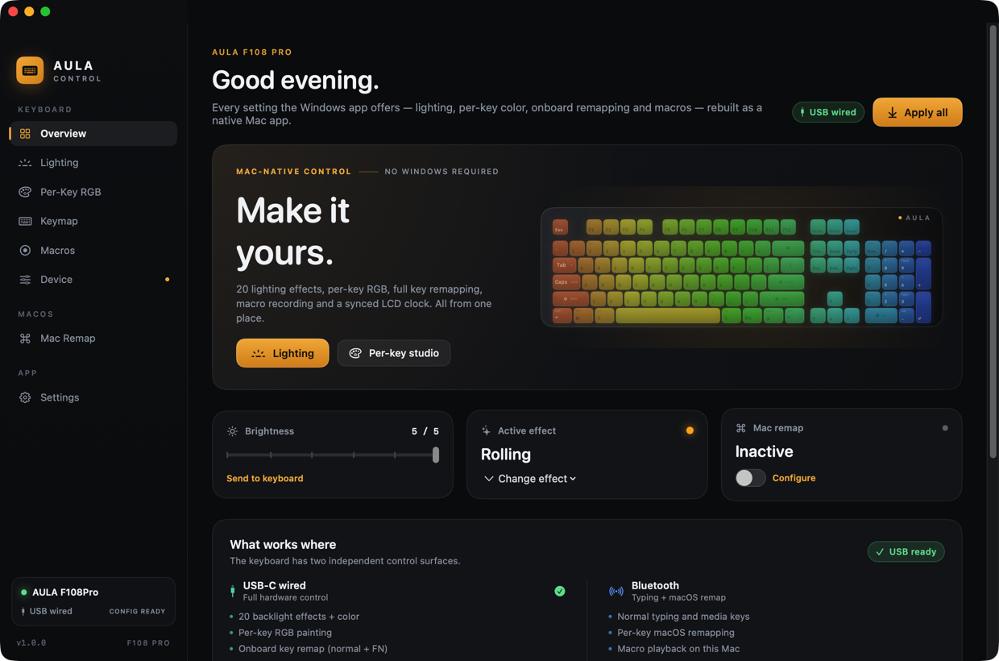
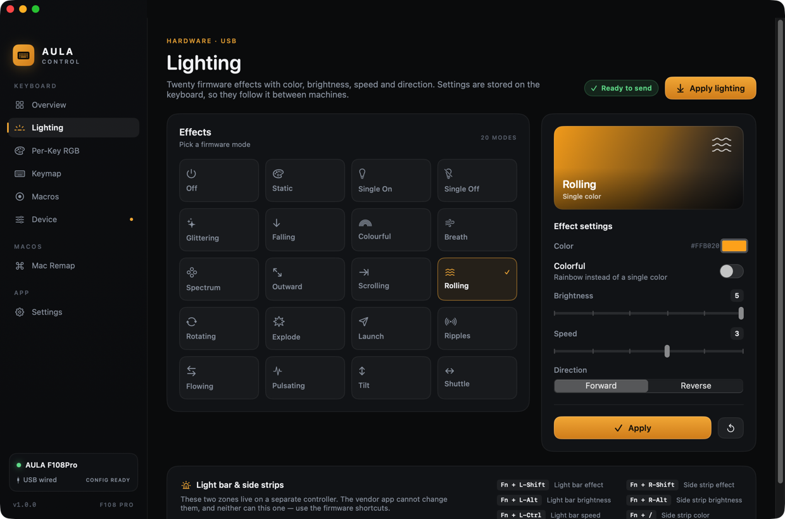
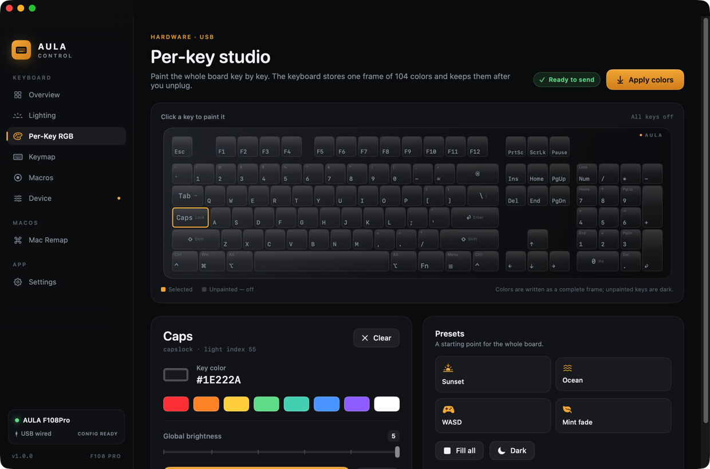
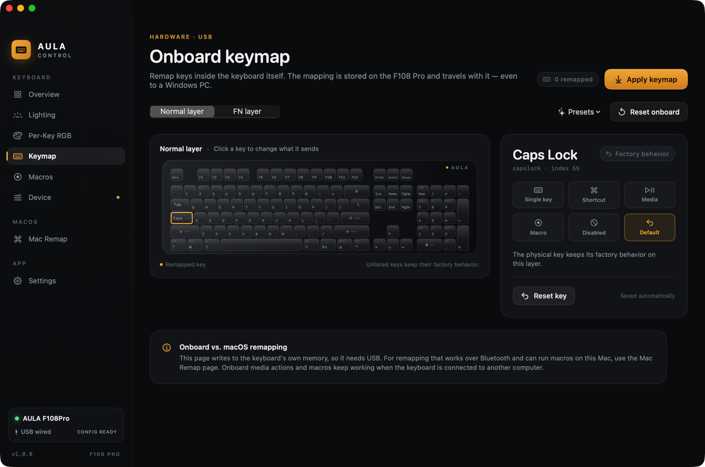
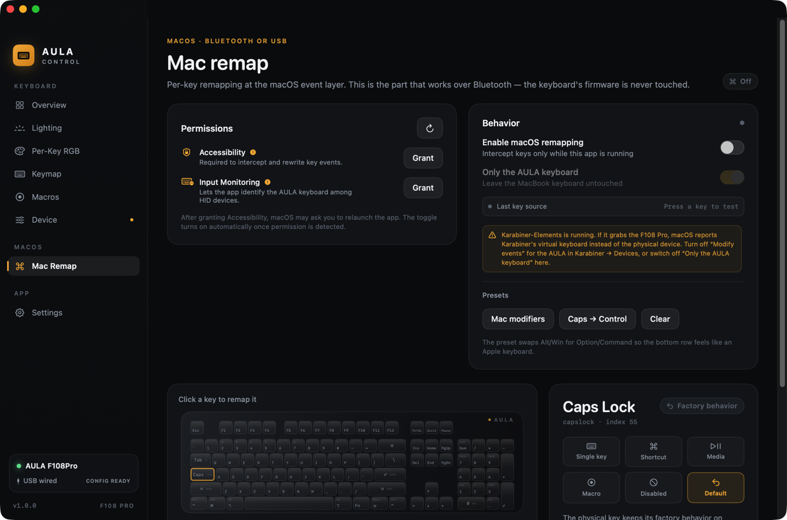

# AULA Control

A native macOS app for the **AULA F108 Pro** mechanical keyboard. It replaces the Windows-only AULA driver for the settings that can be changed from a Mac, and adds something the vendor never shipped: per-key macOS remapping that works over Bluetooth.



## Screenshots

| | |
|---|---|
|  |  |
| **Lighting** — 20 firmware effects | **Per-key studio** — paint all 104 keys |
|  |  |
| **Onboard keymap** — stored on the keyboard | **Mac remap** — works over Bluetooth |

## What it does

**Hardware settings (USB-C, stored on the keyboard)**

- 20 firmware lighting effects with color, brightness, speed and direction
- Per-key RGB painting for all 104 physical keys
- Onboard key remapping for the normal and FN layers (key swaps, shortcuts, media, mouse, macros, disabled keys)
- Macro recording and upload (keyboard + mouse events, delays, repeat modes)
- Sleep timer, key-response/debounce level, FN tap-toggle, Win/Alt+Tab/Alt+F4 locks
- LCD clock sync

**macOS settings (works over Bluetooth or USB)**

- Per-key remapping at the macOS event layer, scoped to the AULA keyboard
- Shortcuts, modifier swaps (Ctrl/Option/Command), media keys, disabled keys
- Macro playback on this Mac
- Presets: Mac modifier layout, Caps Lock → Control, WASD → arrows

**Safety**

- The keyboard protocol is **write-only** — there is no command to read current settings. The app stores your configuration locally and always sends complete tables, so the file is the source of truth.
- Nothing is flashed, and no kernel extension or privileged helper is installed.
- The app opens only the vendor configuration interface (`0xFF13`). It never seizes the keyboard input interface.
- Onboard remaps and macros are sent as complete, bounded tables. The LCD image uploader (the risky part of the vendor protocol) is intentionally not implemented.

## Requirements

- macOS 13 or newer (built and tested on macOS 27.2, Apple silicon)
- AULA F108 Pro, in **USB-C mode** for hardware settings (`Fn + 4`)
- Bluetooth or USB for macOS remapping
- Accessibility permission for remapping; Input Monitoring for HID access

## Hardware verification

Verified on the physical F108 Pro on 2026-10-31, USB-C mode:

- `0C45:800A`, four HID services, configuration interface `0xFF13` (64-byte feature reports)
- `aula verify` → **Configuration interface responded with an ACK**
- Static lighting write → keyboard turned cyan
- Per-key RGB frame → Esc red, W/A/S/D amber
- Onboard remap `F12 → A` → pressing F12 typed “a”
- All test remaps cleared and lighting restored afterwards

## Build and run

```bash
./scripts/build-app.sh
open "dist/AULA Control.app"
```

To produce a drag-to-Applications disk image:

```bash
./scripts/dmg.sh
# dist/AULA Control.dmg
```

The build is ad-hoc signed. macOS may require right-click → **Open** the first time. For reliable permissions and launch-at-login, move it to `/Applications`:

```bash
cp -R "dist/AULA Control.app" /Applications/
open "/Applications/AULA Control.app"
```

Then:

1. Connect the keyboard with USB-C and press `Fn + 4`.
2. Open **Settings → Permissions** (or the Mac Remap page) and grant **Accessibility** and **Input Monitoring**.
3. For macOS remapping, open **Mac Remap**, enable it, and choose a preset or remap individual keys.

You can try the entire interface without hardware: **Settings → Preview mode** (or `⇧⌘P`). Commands are simulated and clearly labelled.

### Command line

A companion CLI is included in the app bundle and built as `aula`:

```bash
.build/debug/aula status
.build/debug/aula probe
.build/debug/aula light breath --color 00C8FF --speed 3
.build/debug/aula perkey --all 101418 --key esc=FF3020 --key space=50C8FF
.build/debug/aula remap --preset mac
.build/debug/aula remap --set capslock=ctrl --set lalt=cmd
.build/debug/aula options --sleep 5 --response 3 --lock-win
.build/debug/aula clock
.build/debug/aula verify
.build/debug/aula push
```

Every command accepts `--dry-run`, which prints the exact 64-byte HID feature reports without opening the keyboard:

```text
$ .build/debug/aula light static --color FF3020 --brightness 4 --dry-run
HID reports (5 feature reports, 64 bytes each):
  00  04 18 00 00 00 00 00 00 00 00 00 00 00 00 00 00 00 00 00 00
  01  04 13 00 00 00 00 00 00 01 00 00 00 00 00 00 00 00 00 00 00
  02  01 FF 30 20 00 00 00 00 00 04 02 00 00 00 55 AA 00 00 00 00
  03  04 02 00 00 00 00 00 00 00 00 00 00 00 00 00 00 00 00 00 00
  04  04 F0 00 00 00 00 00 00 00 00 00 00 00 00 00 00 00 00 00 00
```

`aula verify` performs a read-only handshake against a wired keyboard and reports whether the configuration interface acknowledges commands.

### First hardware run

```bash
# With the USB-C cable connected and the keyboard in USB mode (Fn + 4):
.build/debug/aula status      # Connection: USB wired, Hardware config: available
.build/debug/aula verify      # Configuration interface responded with an ACK
```

If `verify` fails with `kIOReturnNotPermitted`, grant **Input Monitoring** to the app (and to your terminal, if you are running the CLI) in System Settings → Privacy & Security.

## Tests

```bash
swift test
./scripts/smoke.sh
```

The 18 protocol tests verify key layout integrity, bidirectional HID/macOS key maps, exact lighting packets, per-key slot placement, remap slot encoding (including 16-bit consumer usages), macro header/event layout, mouse macro steps, device options, clock sync, product-name matching, macro size limits, and JSON persistence.

## How it works

```text
AULA Control (SwiftUI)
├── Lighting / Per-Key / Keymap / Macros / Device   →  AulaDevice  →  IOHIDDeviceSetReport
│                                                        │
│                                                        └─ USB interface 3, usage page 0xFF13, 64-byte feature reports
├── Mac Remap  →  KeyboardRemapper  →  CGEventTap (field 87 = HID sender)  →  CGEventPost
└── AulaStore  →  ~/Library/Application Support/AULA Control/state.json
```

### Onboard configuration protocol

The F108 Pro exposes four HID interfaces in wired mode (`0C45:800A`):

| Interface | Usage page | Purpose |
|---|---|---|
| 0 | 0x01 | keyboard input |
| 1 | 0x0C/0x01 | consumer / knob / mouse |
| 2 | 0xFF68 | LCD pixels (4096-byte output reports) |
| 3 | 0xFF13 | **configuration** (64-byte feature reports) |

Commands are 64-byte feature reports with report ID 0, 35 ms apart, and each `04 xx` step must be read back (byte 3 = `0x01` ACK) or the firmware ignores the next one. Data tables end with a two-byte marker; the byte order differs by command family (`55 AA` for lighting/clock, `AA 55` for remap/macros/options) and the implementation follows the hardware-verified sources for each.

```text
Lighting:   04 18 → 04 13 (b8=01) → [mode,r,g,b, …, color,brightness,speed,direction, 55 AA] → 04 02 → 04 F0
Per-key:    04 18 → 04 13 → 80 … → 04 02 → 04 F0
            04 18 → 04 23 (b8=09) → 576-byte (index,r,g,b) table → 04 02 → 04 F0
Remap:      04 18 → 04 11 (normal) / 04 27 (FN), b8=09 → 576-byte table → 04 02 → 04 F0
Macros:     04 19 → 04 15 (b8=report count) → buffer → 04 02
Options:    04 18 → 04 17 (b2=01,b8=01) → 00 01 <locks,fntoggle,sleep,response> … AA 55 → 04 02
Clock:      04 18 → 04 28 (b8=01) → 00 01 5A year month day hour minute second 00 weekday … 55 AA → 04 02
```

The full reference is in [docs/PROTOCOL.md](docs/PROTOCOL.md), based on the verified work of the projects listed below.

### macOS remapping

The event tap uses the undocumented `CGEventField(rawValue: 87)` (IORegistry sender ID) to decide whether a key came from the AULA. Synthetic events posted by the app carry a marker in `eventSourceUserData` and are ignored. No root, no kernel extension, no virtual HID device.

**Karabiner-Elements interaction:** if Karabiner grabs the keyboard, macOS reports Karabiner's virtual keyboard as the sender, so "Only the AULA keyboard" cannot match. The Mac Remap page detects this and explains the fix: disable *Modify events* for the AULA in Karabiner → Devices, or turn off "Only the AULA keyboard" in AULA Control. The page also shows the last key source for diagnosis.

## Limitations

- **Bluetooth has no vendor/config protocol.** Lighting, per-key RGB, onboard remap and macros require USB-C. This is an AULA firmware limitation, not an app limitation.
- The **2.4 GHz dongle** uses a different, reduced protocol; the app detects it but hardware controls are wired-only. Use USB-C for the full feature set.
- The **light bar and side strips** are on a separate firmware controller. AULA's own app cannot control them; use the FN shortcuts.
- **LCD image/GIF upload is not included** — the upstream research documents a real risk of permanently corrupting the keyboard's menu graphics when the frame limit is exceeded.
- The protocol is **write-only**; after a reconnect, use **Apply all** to restore your stored configuration. Enable *Apply saved config on USB connect* to do it automatically.
- **Macro slots are positional.** Deleting a macro shifts later slots; re-check key bindings after deleting.
- **Secure Input** (password fields, some apps) blocks event taps by design. Remaps pause there.
- Ad-hoc signing means TCC may ask again after a rebuild. Move the app to `/Applications` and grant permissions once.

## Credits

This app would not exist without the people who reverse-engineered the F108 Pro:

- [parsiya/f108-pro](https://github.com/parsiya/f108-pro) — MIT, the most complete protocol write-up (lighting, remap, macros, clock, LCD)
- [bacoinz/aula-studio](https://github.com/bacoinz/aula-studio) — hardware-verified notes for options, macros and the 2.4 GHz dongle
- [sarequl/aula-studio](https://github.com/sarequl/aula-studio) — MIT, a native macOS implementation and useful IOKit validation
- [AuRoN89/AULA-F108-PRO-Reverse-Engineering](https://github.com/AuRoN89/AULA-F108-PRO-Reverse-Engineering) — teardown and MCU identification
- [Punkster81/AULA-F108-Driver](https://github.com/Punkster81/AULA-F108-Driver), [ThePrimeDev/SignalRgb_AulaF108Pro](https://github.com/ThePrimeDev/SignalRgb_AulaF108Pro), [hcode10/OpenRGB-With-AulaF108Pro-support](https://github.com/hcode10/OpenRGB-With-AulaF108Pro-support) — LED maps and captures
- AULA / 狼蛛 for the hardware (not affiliated; no vendor code is included)

## License

MIT — see [LICENSE](LICENSE).
