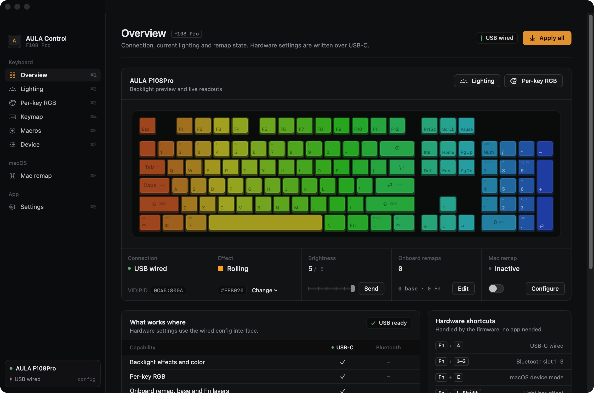
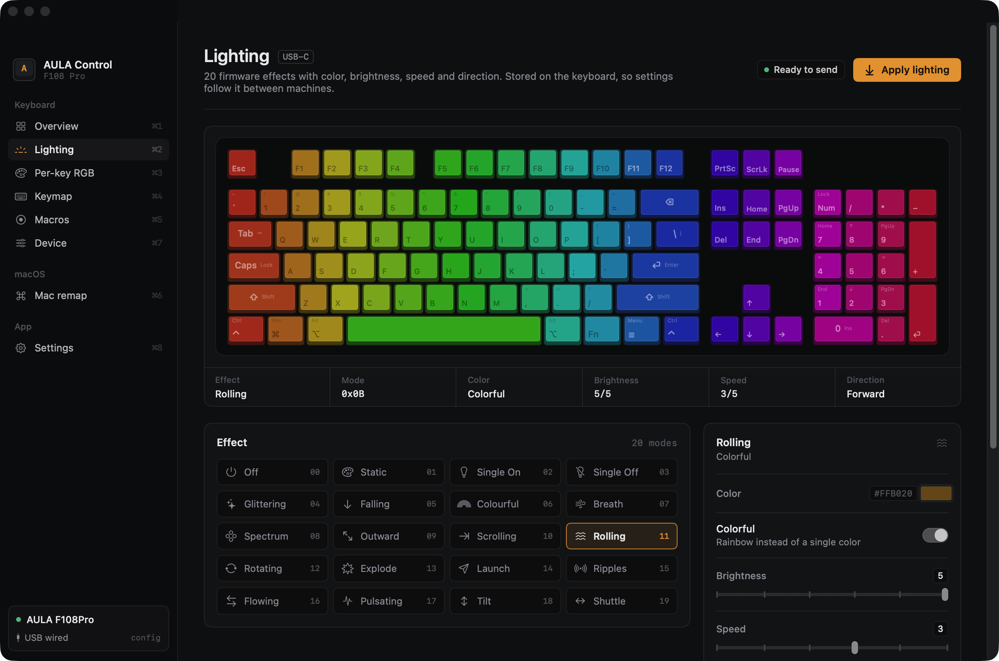
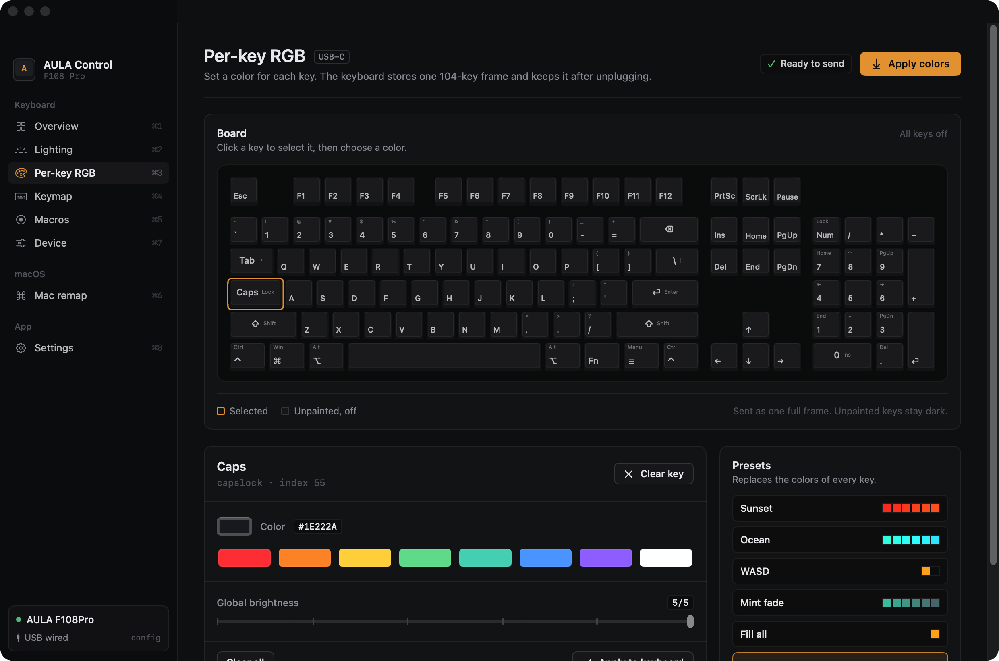
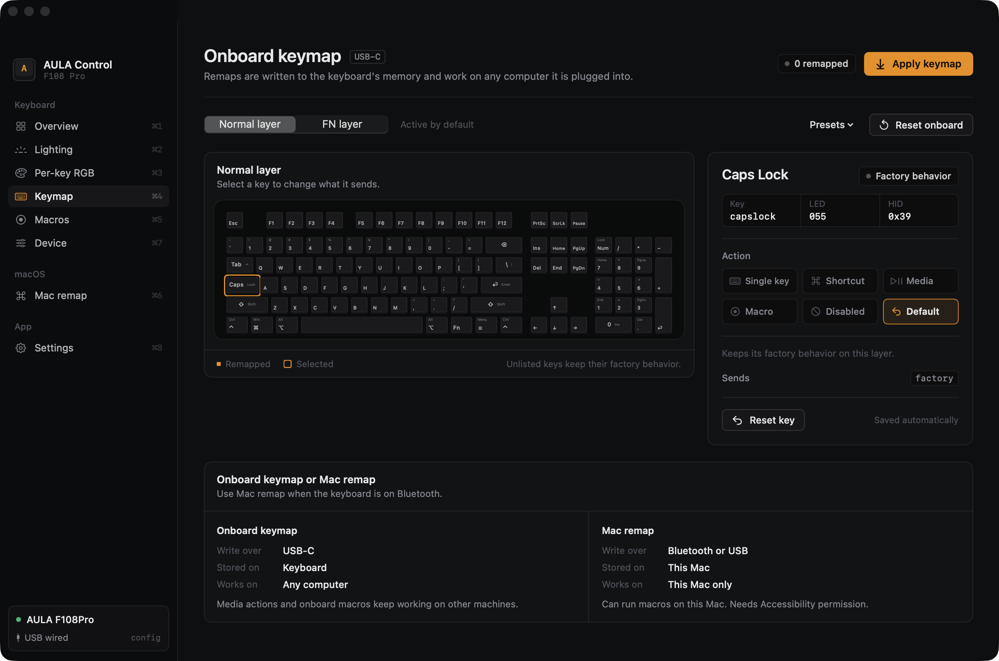
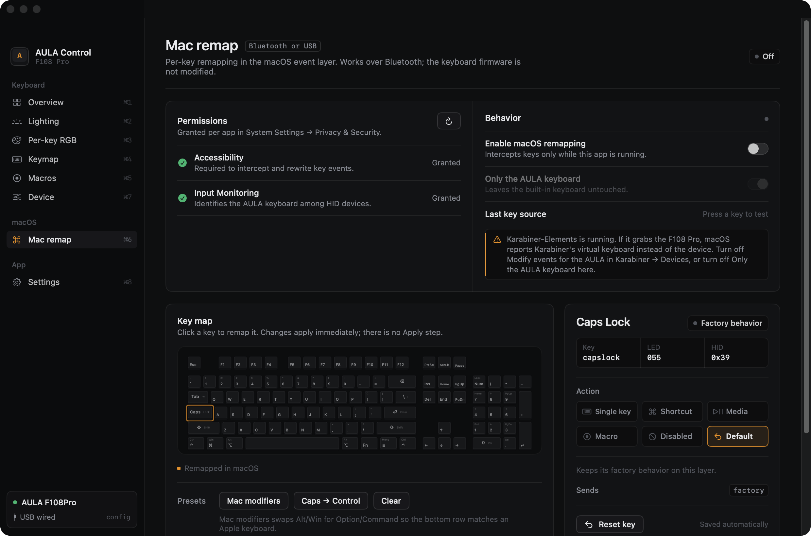

# AULA Control

A native macOS app for the **AULA F108 Pro** keyboard. It covers the settings the Windows-only vendor driver exposes — lighting, per-key RGB, onboard remapping, macros and device options — and adds per-key remapping at the macOS level, which also works over Bluetooth.



## Install

**Homebrew**

```bash
brew trust --cask rakshithbhat03/tap/aula-control   # Homebrew 7+ only loads trusted third-party casks
brew install --cask rakshithbhat03/tap/aula-control
```

This installs `AULA Control.app` and puts the `aula` command-line tool on your `PATH`.

**Disk image**

Download `AULA-Control-<version>.dmg` from [Releases](https://github.com/RakshithBhat03/aula-control/releases), open it and drag the app to Applications. The app is ad-hoc signed, not notarized, so the first launch needs right-click → **Open** (or `xattr -dr com.apple.quarantine "/Applications/AULA Control.app"`).

Universal binary (Apple silicon and Intel), macOS 13 or newer.

## Screenshots

| | |
|---|---|
|  |  |
| **Lighting** — the 20 firmware effects | **Per-key RGB** — paint all 104 keys |
|  |  |
| **Keymap** — onboard remaps, normal and FN layers | **Mac remap** — remapping that works over Bluetooth |

## What works

| | USB-C | Bluetooth |
|---|:---:|:---:|
| 20 lighting effects with color, brightness, speed and direction | ✓ | |
| Per-key RGB for all 104 keys | ✓ | |
| Onboard remapping, normal and FN layers (keys, shortcuts, media, mouse, macros, disabled) | ✓ | |
| Macro recording and upload (keys, mouse, delays, repeat modes) | ✓ | |
| Sleep timer, key response, FN tap-toggle, Win / Alt+Tab / Alt+F4 locks | ✓ | |
| LCD clock sync | ✓ | |
| macOS-level remapping, scoped to the AULA keyboard | ✓ | ✓ |
| Macro playback on this Mac | ✓ | ✓ |

Hardware settings are stored on the keyboard and follow it to other computers. Bluetooth has no configuration channel in the AULA firmware, so those need the cable; macOS remapping works over either.

The 2.4 GHz dongle is detected, but it uses a different, reduced protocol; use USB-C for hardware settings.

## Getting started

1. Connect the keyboard with USB-C and switch it to wired mode with <kbd>Fn</kbd> + <kbd>4</kbd>.
2. Open AULA Control. The sidebar shows **USB wired** once the configuration interface is found.
3. Grant **Input Monitoring** (and **Accessibility**, for macOS remapping) when asked, or from **Settings → Permissions**.
4. Pick an effect in **Lighting**, paint keys in **Per-key RGB**, or remap keys in **Keymap**, then press **Apply**.

The keyboard can't report its current settings back, so the app keeps your configuration in `~/Library/Application Support/AULA Control/state.json` and always sends complete tables. After plugging the keyboard into another machine, **Apply all** (<kbd>⇧</kbd><kbd>⌘</kbd><kbd>R</kbd>) restores it. Turn on **Apply saved config on USB connect** to do that automatically.

**Preview mode** (<kbd>⇧</kbd><kbd>⌘</kbd><kbd>P</kbd>) lets you try every screen without a keyboard; commands are simulated and labelled.

### macOS remapping

**Mac remap** rewrites keys at the macOS event layer, so it works over Bluetooth and never touches the keyboard's firmware. It supports single keys, shortcuts, modifier swaps, media keys, disabled keys and macro playback, plus presets for a Mac modifier layout, Caps Lock → Control, and WASD → arrows. By default it only affects the AULA keyboard; your MacBook's built-in keyboard is left alone.

If Karabiner-Elements grabs the AULA, macOS sees Karabiner's virtual keyboard instead. Either turn off *Modify events* for the AULA in Karabiner → Devices, or switch off **Only the AULA keyboard** in AULA Control. The Mac remap page detects this and shows the last key source.

## Command line

The `aula` tool drives the same protocol from a terminal:

```bash
aula status                                      # connection and protocol availability
aula light breath --color 00C8FF --speed 3       # lighting effect
aula perkey --all 101418 --key esc=FF3020        # per-key RGB
aula remap --preset mac                          # onboard keymap preset
aula remap --set capslock=ctrl --set lalt=cmd    # individual remaps
aula remap --fn --set f1=media:play              # FN layer
aula macro --text "Hello"                        # typing macro (replaces the macro bank)
aula options --sleep 5 --response 3 --lock-win   # device options
aula clock                                       # sync the LCD clock
aula push                                        # push the app's saved configuration
```

Every command accepts `--dry-run`, which prints the exact 64-byte HID reports without opening the keyboard. `aula --help` lists all options.

## Limitations

- **Bluetooth has no configuration protocol.** Lighting, per-key RGB, onboard remaps, macros and options require USB-C. This is a firmware limitation.
- The **light bar and side strips** are driven by a separate controller that neither this app nor AULA's software can reach. Use the FN shortcuts.
- **LCD image and GIF upload is not implemented.** Exceeding the frame limit can permanently corrupt the keyboard's menu graphics.
- **Macro slots are positional.** Deleting a macro shifts later slots, so check key bindings afterwards.
- **Secure Input** (password fields and some apps) blocks event taps by design; macOS remaps pause there.
- Because the app is ad-hoc signed, macOS may ask for permissions again after an update.

## Safety

- Nothing is flashed. No kernel extension, driver or privileged helper is installed.
- The app opens only the vendor configuration interface (usage page `0xFF13`) and never seizes the keyboard's input interface.
- Remaps and macros are sent as complete, bounded tables.

## Build from source

Requires Xcode 15 or newer.

```bash
./scripts/build-app.sh          # dist/AULA Control.app (universal; ARCH=native for this Mac only)
./scripts/dmg.sh                # dist/AULA-Control-<version>.dmg
```

The protocol is documented in [docs/PROTOCOL.md](docs/PROTOCOL.md).

## Credits

This app builds on the people who reverse-engineered the F108 Pro:

- [parsiya/f108-pro](https://github.com/parsiya/f108-pro) — the most complete protocol write-up (lighting, remap, macros, clock, LCD)
- [bacoinz/aula-studio](https://github.com/bacoinz/aula-studio) — hardware-verified notes for options, macros and the 2.4 GHz dongle
- [sarequl/aula-studio](https://github.com/sarequl/aula-studio) — a native macOS implementation and IOKit reference
- [AuRoN89/AULA-F108-PRO-Reverse-Engineering](https://github.com/AuRoN89/AULA-F108-PRO-Reverse-Engineering) — teardown and MCU identification
- [Punkster81/AULA-F108-Driver](https://github.com/Punkster81/AULA-F108-Driver), [ThePrimeDev/SignalRgb_AulaF108Pro](https://github.com/ThePrimeDev/SignalRgb_AulaF108Pro), [hcode10/OpenRGB-With-AulaF108Pro-support](https://github.com/hcode10/OpenRGB-With-AulaF108Pro-support) — LED maps and captures

Not affiliated with AULA. No vendor code is included.

## License

MIT — see [LICENSE](LICENSE).
